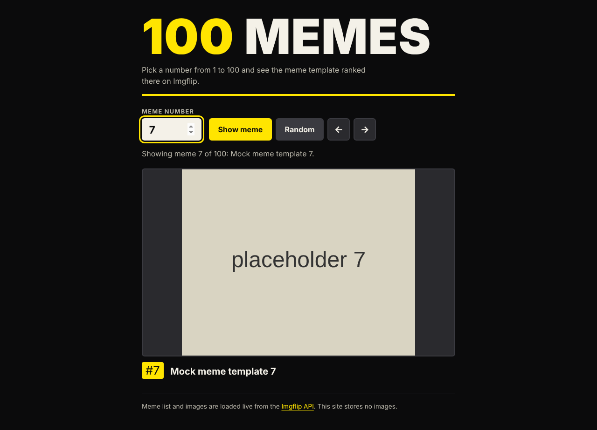
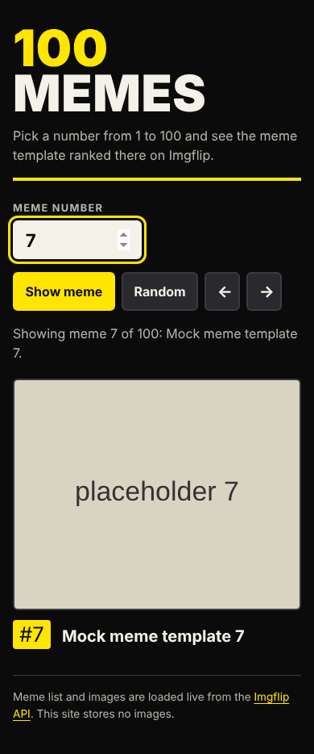

# 100 Memes

Type a number from 1 to 100 and see the meme template ranked there. The list comes from the public [Imgflip API](https://imgflip.com/api) (`GET https://api.imgflip.com/get_memes`, no API key). Plain HTML, CSS and JavaScript, no build step, no dependencies.

Live demo: https://100memes-elyp.vercel.app





The screenshots use placeholder data, see "Verification" below.

## How it works

- On load the page fetches the meme list once and keeps it in memory. Every lookup after that is instant and makes no further requests.
- The image is shown straight from the URL that Imgflip returns. No meme image is stored in or committed to this repository.
- Number `n` shows the `n`-th template in the list, from 1 to 100. The original code used the number as a zero-based index and its label said 1 to 99, which skipped the first meme and made the 100th unreachable. That is fixed.
- Random, previous and next buttons are included. Previous and next wrap around.

## Failure handling

- Network failure, timeout (8 seconds), non-200 status, invalid JSON or an unexpected payload shape all show a readable error message and a "Try again" button.
- Only entries with a name and an `https` image URL are used.
- If a single image fails to load, the frame shows a fallback message instead of a broken icon. The image has the meme name as alt text.
- Invalid input (empty, decimal, out of range) shows an inline message and sets `aria-invalid`.
- Names from the API are written with `textContent`, never `innerHTML`.

## Run it

```sh
python3 -m http.server 5263
# open http://localhost:5263
```

An internet connection is needed to reach the Imgflip API.

## Verification

The sandbox I used has no access to api.imgflip.com, so I could not load the real API here. I ran the page in headless Chromium (Playwright) with the API and image requests intercepted and answered with placeholder data ("Mock meme template N" with a grey placeholder image). With that I checked: first load, numbers 1 and 100, out of range and decimal input, empty input, previous/next wrap, random, retry after a network failure, HTTP 500, `success: false`, invalid JSON, a failing image, and 390px layout. There were no page errors. The real Imgflip response shape (`success`, `data.memes[].name`, `data.memes[].url`) is taken from the original code and the Imgflip documentation, but I did not call the live service. There are no automated tests in the repo.

## Known limitations

- Depends on a third-party service. If Imgflip is down, changes its response, or blocks the domain, the app shows the error state and nothing else.
- Ranking order and the images belong to Imgflip and can change over time, so "meme 7" is not stable.
- Meme images are owned by their respective creators and are displayed through Imgflip's API as intended by the API. Check Imgflip's terms before using this beyond a demo.

## Notes

UI and code quality improvements were made with AI assistance (Claude, Anthropic), reviewed and verified by building and running the app.
